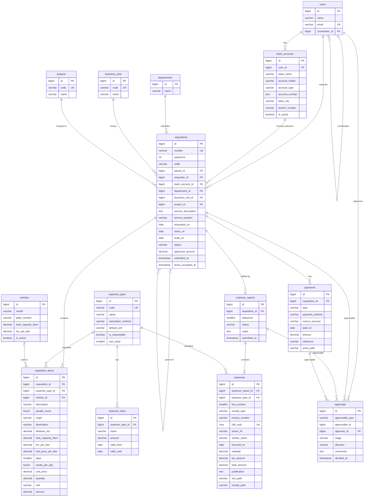

# Base de datos

Esquema de `diapsa_requisitions` (MySQL 8.4), aprobado. Las migraciones están en `database/migrations`.

## Convenciones

- Tablas, campos y valores de estados en **inglés**; la interfaz se muestra en español.
- Tablas en plural y `snake_case`: `requisitions`, `requisition_items`.
- Llaves foráneas como `singular_id`: `requisition_id`, `expense_type_id`.
- Fechas sin hora terminan en `_on` (`requested_on`); fechas con hora en `_at` (`submitted_at`).
- Montos en `decimal(12,2)`, nunca `float`.
- Términos mexicanos sin traducción: `cfdi_uuid`, `issuer_rfc`, `clabe`.
- Todas las tablas llevan `created_at` y `updated_at`; las principales también `deleted_at` (borrado lógico).
- Los valores que se calculan **no se guardan** (ver [campos calculados](#campos-calculados)).

## Diagrama relacional

`approvals` es una relación polimórfica: `approvable_type` indica si el registro es de una requisición (`requisition`), de una comprobación (`expense_report`) o de un pago (`payment`, el depósito que registra el solicitante), y `approvable_id` cuál. Los alias están en el morph map de `AppServiceProvider`.

Los roles y permisos usan las tablas de `spatie/laravel-permission` (`roles`, `permissions`, `model_has_roles`, `model_has_permissions` y `role_has_permissions`), que no aparecen en el diagrama.

## Diccionario de datos

La columna **Origen** indica de qué parte de los formatos de Excel viene cada dato.

### users

Tabla de Laravel; se le agrega `coordinator_id`.

| Campo          | Tipo                              | Descripción                                | Origen               |
| -------------- | --------------------------------- | ------------------------------------------ | -------------------- |
| id             | bigint unsigned, PK               |                                            |                      |
| name           | varchar(255)                      | Nombre completo                            | Solicitante          |
| email          | varchar(255), único               | Correo para iniciar sesión                 |                      |
| coordinator_id | bigint unsigned, FK → users, nulo | Coordinador que autoriza sus requisiciones | Autoriza coordinador |

### bank_accounts

Cuentas del empleado para depósitos y reembolsos. No se editan: si cambia la cuenta se da de alta una nueva y la anterior se desactiva, para que las requisiciones viejas conserven a qué cuenta se depositó.

| Campo          | Tipo                        | Descripción                              | Origen                   |
| -------------- | --------------------------- | ---------------------------------------- | ------------------------ |
| id             | bigint unsigned, PK         |                                          |                          |
| user_id        | bigint unsigned, FK → users | Dueño de la cuenta                       |                          |
| bank_name      | varchar(100)                | Banco                                    | Banco                    |
| account_holder | varchar(150)                | Titular                                  | Nombre (datos bancarios) |
| account_type   | varchar(20)                 | `debit_card`, `account` o `clabe`        | "(No. de tarjeta)"       |
| account_number | text, cifrado               | Número de tarjeta, cuenta o CLABE        | Cuenta / Cta. bancaria   |
| bank_city      | varchar(100), nulo          | Plaza                                    | Plaza                    |
| branch_number  | varchar(20), nulo           | Sucursal                                 | Sucursal                 |
| is_active      | boolean, por defecto true   | Si se puede usar en nuevas requisiciones |                          |

### departments

| Campo | Tipo                | Descripción                            | Origen |
| ----- | ------------------- | -------------------------------------- | ------ |
| id    | bigint unsigned, PK |                                        |        |
| name  | varchar(100)        | Nombre del área (por ejemplo, Técnico) | Área   |

### business_units

| Campo | Tipo                | Descripción                       | Origen            |
| ----- | ------------------- | --------------------------------- | ----------------- |
| id    | bigint unsigned, PK |                                   |                   |
| code  | varchar(10), único  | Clave que va en el folio (`SALT`) | Folio             |
| name  | varchar(100)        | Nombre (Saltillo)                 | Unidad de negocio |

### projects

| Campo | Tipo                | Descripción              | Origen   |
| ----- | ------------------- | ------------------------ | -------- |
| id    | bigint unsigned, PK |                          |          |
| code  | varchar(50), único  | Clave que va en el folio | Folio    |
| name  | varchar(150)        | Nombre del proyecto      | Proyecto |

### vehicles

| Campo                | Tipo                      | Descripción          | Origen                         |
| -------------------- | ------------------------- | -------------------- | ------------------------------ |
| id                   | bigint unsigned, PK       |                      |                                |
| model                | varchar(100)              | Modelo del vehículo  | Etiqueta del concepto Traslado |
| plate_number         | varchar(20), nulo         | Placas               |                                |
| tank_capacity_liters | decimal(6,2)              | Capacidad del tanque | Auto litros del tanque         |
| km_per_liter         | decimal(6,2)              | Rendimiento          | Eficiencia km/L                |
| is_active            | boolean, por defecto true | Si se puede elegir   |                                |

### expense_types

Un solo catálogo para los conceptos de la requisición y las categorías de la comprobación (ver el catálogo inicial en [reglas de negocio](reglas-de-negocio.md#tipos-de-gasto)).

| Campo              | Tipo                      | Descripción                                           | Origen                          |
| ------------------ | ------------------------- | ----------------------------------------------------- | ------------------------------- |
| id                 | bigint unsigned, PK       |                                                       |                                 |
| code               | varchar(30), único        | Clave interna (`fuel`, `meals`…)                      |                                 |
| name               | varchar(100)              | Nombre que se muestra                                 | Concepto / columna de categoría |
| calculation_method | varchar(30)               | Cómo se calcula el importe en la requisición          | Fórmulas del Excel              |
| default_unit       | varchar(20)               | Unidad por defecto                                    | Unidad                          |
| is_requestable     | boolean, por defecto true | Si se puede pedir en una requisición                  |                                 |
| sort_order         | smallint unsigned         | Orden en pantalla, igual al de las columnas del Excel |                                 |

### expense_rates

Tarifas con vigencia, para que un cambio no altere requisiciones anteriores.

| Campo           | Tipo                                | Descripción                      | Origen                                    |
| --------------- | ----------------------------------- | -------------------------------- | ----------------------------------------- |
| id              | bigint unsigned, PK                 |                                  |                                           |
| expense_type_id | bigint unsigned, FK → expense_types | Tipo de gasto                    |                                           |
| name            | varchar(100)                        | Por ejemplo "Comida con factura" | Compromisos                               |
| amount          | decimal(12,2)                       | Monto                            | Autorizado por comida, costo de gasolina… |
| valid_from      | date                                | Inicio de vigencia               |                                           |
| valid_until     | date, nulo                          | Fin de vigencia; nulo = vigente  |                                           |

### requisitions

| Campo               | Tipo                                     | Descripción                                                    | Origen                                 |
| ------------------- | ---------------------------------------- | -------------------------------------------------------------- | -------------------------------------- |
| id                  | bigint unsigned, PK                      |                                                                |                                        |
| number              | varchar(50), único                       | Folio completo, generado por el sistema                        | No. de requisición                     |
| sequence            | int unsigned                             | Consecutivo del folio                                          | Folio                                  |
| suffix              | varchar(5), nulo                         | Sufijo de requisición complementaria (`B`)                     | Folio                                  |
| parent_id           | bigint unsigned, FK → requisitions, nulo | Requisición original de una complementaria                     |                                        |
| requester_id        | bigint unsigned, FK → users              | Solicitante                                                    | Solicitante                            |
| bank_account_id     | bigint unsigned, FK → bank_accounts      | Cuenta donde se deposita                                       | Datos bancarios                        |
| department_id       | bigint unsigned, FK → departments        | Área                                                           | Área                                   |
| business_unit_id    | bigint unsigned, FK → business_units     | Unidad de negocio                                              | Folio / unidad de negocio              |
| project_id          | bigint unsigned, FK → projects           | Proyecto                                                       | Proyecto                               |
| service_description | text                                     | Qué se va a hacer                                              | Descripción del servicio               |
| service_location    | varchar(100), nulo                       | Ciudad del servicio                                            | Ciudad sin etiqueta en la comprobación |
| requested_on        | date                                     | Fecha de solicitud                                             | Fecha de solicitud                     |
| starts_on / ends_on | date                                     | Fechas del servicio                                            | Duración de servicio                   |
| status              | varchar(30)                              | Estado (ver [reglas de negocio](reglas-de-negocio.md#estados)) |                                        |
| approved_amount     | decimal(12,2), nulo                      | Total autorizado; nulo hasta que se aprueba                    | Total depósito aprobado                |
| submitted_at        | timestamp, nulo                          | Cuándo el solicitante la envió                                 | Firma del solicitante                  |
| terms_accepted_at   | timestamp, nulo                          | Cuándo aceptó los compromisos                                  | Compromisos                            |

### requisition_items

Cada renglón de la tabla de conceptos. Cada concepto usa solo los campos que le aplican; los demás quedan nulos.

| Campo                | Tipo                                 | Descripción                            | Origen                             |
| -------------------- | ------------------------------------ | -------------------------------------- | ---------------------------------- |
| id                   | bigint unsigned, PK                  |                                        |                                    |
| requisition_id       | bigint unsigned, FK → requisitions   | Requisición                            |                                    |
| expense_type_id      | bigint unsigned, FK → expense_types  | Tipo de gasto                          | Concepto                           |
| vehicle_id           | bigint unsigned, FK → vehicles, nulo | Vehículo (solo traslado)               | Etiqueta del concepto              |
| description          | varchar(255), nulo                   | Descripción libre                      | Descripción                        |
| people_count         | tinyint unsigned, nulo               | Número de personas                     | # de personas                      |
| origin / destination | varchar(150), nulo                   | Origen y destino                       | Origen / Destino                   |
| distance_km          | decimal(8,2), nulo                   | Distancia                              | Distancia (km)                     |
| tank_capacity_liters | decimal(6,2), nulo                   | Copia del vehículo al momento de pedir | Auto litros del tanque             |
| km_per_liter         | decimal(6,2), nulo                   | Copia del vehículo al momento de pedir | Eficiencia km/L                    |
| fuel_price_per_liter | decimal(8,2), nulo                   | Precio del litro                       | Costo de gasolina                  |
| days                 | smallint unsigned, nulo              | Días                                   | Cantidad de días / días este viaje |
| meals_per_day        | tinyint unsigned, nulo               | Comidas por día                        | Veces por día                      |
| unit_price           | decimal(12,2)                        | Precio unitario                        | Precio unitario                    |
| quantity             | decimal(8,2)                         | Cantidad                               | Cantidad                           |
| unit                 | varchar(20)                          | Unidad                                 | Unidad                             |
| amount               | decimal(12,2)                        | Importe; se calcula y se guarda        | Cantidad final por concepto        |

### payments

Movimientos de dinero entre DIAPSA y el empleado.

| Campo          | Tipo                               | Descripción                                                | Origen                              |
| -------------- | ---------------------------------- | ---------------------------------------------------------- | ----------------------------------- |
| id             | bigint unsigned, PK                |                                                            |                                     |
| requisition_id | bigint unsigned, FK → requisitions | Requisición                                                |                                     |
| type           | varchar(30)                        | `advance`, `reimbursement`, `refund` o `payroll_deduction` | Depósito / pago recibido / sobrante |
| payment_method | varchar(20)                        | `card`, `transfer` o `cash`                                | Tarjeta                             |
| source_account | varchar(100), nulo                 | Cuenta de la empresa de donde sale                         | Renglón de depósito                 |
| paid_on        | date                               | Fecha                                                      | Renglón de depósito                 |
| amount         | decimal(12,2)                      | Importe                                                    | Importe abonado                     |
| reference      | varchar(100), nulo                 | Referencia bancaria                                        |                                     |
| proof_path     | varchar(255), nulo                 | Archivo del comprobante de pago                            |                                     |

### expense_reports

| Campo          | Tipo                               | Descripción                                                    | Origen                                        |
| -------------- | ---------------------------------- | -------------------------------------------------------------- | --------------------------------------------- |
| id             | bigint unsigned, PK                |                                                                |                                               |
| requisition_id | bigint unsigned, FK → requisitions | Requisición que se comprueba                                   | No. de requisición                            |
| sequence       | smallint unsigned                  | Número de comprobación parcial                                 | No. de partida o partidas                     |
| status         | varchar(30)                        | Estado (ver [reglas de negocio](reglas-de-negocio.md#estados)) |                                               |
| notes          | text, nulo                         | Observaciones                                                  | Observaciones                                 |
| submitted_at   | timestamp, nulo                    | Cuándo se envió                                                | Fecha de comprobación / firma del solicitante |

### expenses

Cada factura o ticket es un renglón, con su tipo de gasto. Sustituye a las columnas por categoría del Excel.

| Campo             | Tipo                                  | Descripción                                               | Origen                     |
| ----------------- | ------------------------------------- | --------------------------------------------------------- | -------------------------- |
| id                | bigint unsigned, PK                   |                                                           |                            |
| expense_report_id | bigint unsigned, FK → expense_reports | Comprobación                                              |                            |
| expense_type_id   | bigint unsigned, FK → expense_types   | Categoría                                                 | Columna de categoría       |
| line_number       | smallint unsigned                     | Número de renglón                                         | Consecutivo                |
| receipt_type      | varchar(30)                           | `cfdi_invoice`, `non_fiscal_receipt` o `no_receipt`       |                            |
| invoice_number    | varchar(100), nulo                    | Serie y folio de la factura                               | No. de factura             |
| cfdi_uuid         | char(36), único, nulo                 | UUID del CFDI; evita comprobar dos veces la misma factura |                            |
| issuer_rfc        | varchar(13), nulo                     | RFC del emisor                                            |                            |
| vendor_name       | varchar(200)                          | Establecimiento                                           | Nombre del establecimiento |
| incurred_on       | date                                  | Fecha del gasto                                           |                            |
| subtotal          | decimal(12,2)                         | Subtotal                                                  |                            |
| tax_amount        | decimal(12,2)                         | IVA                                                       | IVA                        |
| total_amount      | decimal(12,2)                         | Total                                                     | Total                      |
| justification     | text, nulo                            | Justificación (excesos o gastos sin factura)              | Compromisos                |
| xml_path          | varchar(255), nulo                    | Archivo XML del CFDI                                      |                            |
| receipt_path      | varchar(255), nulo                    | PDF o foto del comprobante                                |                            |

### approvals

| Campo           | Tipo                        | Descripción                                                                                        | Origen                                                                        |
| --------------- | --------------------------- | -------------------------------------------------------------------------------------------------- | ----------------------------------------------------------------------------- |
| id              | bigint unsigned, PK         |                                                                                                    |                                                                               |
| approvable_type | varchar(50)                 | `requisition`, `expense_report` o `payment`                                                        |                                                                               |
| approvable_id   | bigint unsigned             | Id de la requisición, comprobación o pago                                                          |                                                                               |
| approver_id     | bigint unsigned, FK → users | Quién autoriza o confirma; en la confirmación del depósito es el solicitante                       | Autoriza coordinador / administración / firma de autorización / pago recibido |
| stage           | varchar(30)                 | `coordinator`, `manager` o `deposit_confirmation`                                                  |                                                                               |
| decision        | varchar(20)                 | `approved`, `rejected` o `returned`; en la confirmación del depósito, `confirmed` o `not_received` |                                                                               |
| comments        | text, nulo                  | Comentario                                                                                         |                                                                               |
| decided_at      | timestamp                   | Cuándo se registró                                                                                 |                                                                               |

## Campos calculados

No se guardan; el sistema los calcula al mostrarlos.

| Dato del Excel                                 | Cálculo                                                                   |
| ---------------------------------------------- | ------------------------------------------------------------------------- |
| Km por tanque                                  | `tank_capacity_liters × km_per_liter`                                     |
| Litros consumidos                              | `distance_km ÷ km_per_liter`                                              |
| Tanques estimados                              | litros consumidos ÷ `tank_capacity_liters`                                |
| Suma de comprobación y diferencia por concepto | Suma de `expenses.total_amount` del mismo tipo de gasto, contra lo pedido |
| Presupuesto por categoría (comprobación)       | Suma de `requisition_items.amount` por `expense_type_id`                  |
| Gastado por categoría                          | Suma de `expenses.total_amount` por `expense_type_id`                     |
| Disponible                                     | Presupuesto − gastado                                                     |
| Total a pagar                                  | Ver [saldo](reglas-de-negocio.md#saldo-y-cierre)                          |

## Equivalencias español → inglés

| Excel / español                      | Tabla               |
| ------------------------------------ | ------------------- |
| Requisición                          | `requisitions`      |
| Partida / concepto de la requisición | `requisition_items` |
| Concepto y categoría de gasto        | `expense_types`     |
| Tarifa                               | `expense_rates`     |
| Depósito, reembolso, sobrante        | `payments`          |
| Comprobación de gastos               | `expense_reports`   |
| Gasto (factura o ticket)             | `expenses`          |
| Autorización / firma / pago recibido | `approvals`         |
| Área                                 | `departments`       |
| Unidad de negocio                    | `business_units`    |
| Proyecto                             | `projects`          |
| Vehículo                             | `vehicles`          |
| Datos bancarios                      | `bank_accounts`     |
